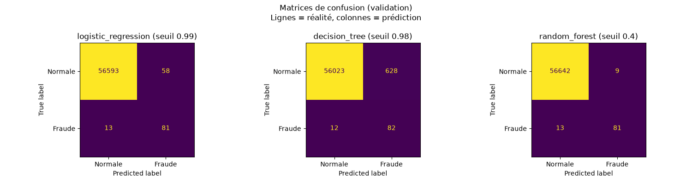
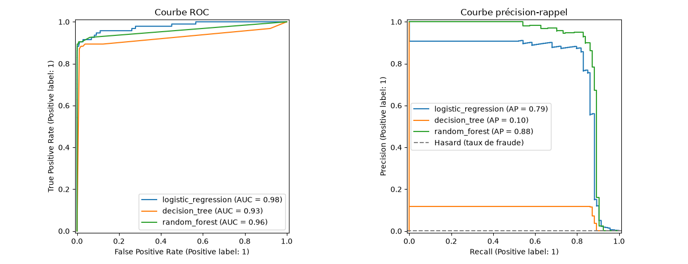
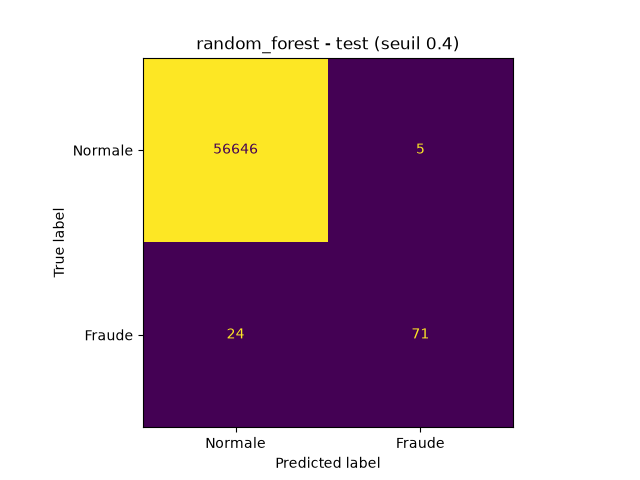

# Rapport d'évaluation des performances – Détection de fraude

## 1. Démarche

- **Données** : 283 726 transactions après suppression des doublons, dont 473 fraudes (0,17 %).
- **Découpage** stratifié 60/20/20 avec la graine 42 : entraînement 170 235, validation 56 745 (94 fraudes), test 56 746 (95 fraudes).
- **Modèles comparés** : régression logistique, arbre de décision (profondeur 5) et forêt aléatoire (200 arbres), tous avec `class_weight="balanced"`.
- **Seuil de décision** choisi sur la validation : parmi les seuils qui atteignent un rappel de 0,85, celui qui a la meilleure précision.
- **Choix du modèle** sur la PR-AUC de validation, puis **une seule** évaluation sur le jeu de test.

## 2. Tableau comparatif des modèles (validation)

**Métriques**

| Modèle | Seuil | Rappel | Précision | F1 | PR-AUC | ROC-AUC | FPR | FNR | Accuracy |
|---|---|---|---|---|---|---|---|---|---|
| Régression logistique | 0,99 | 0,86 | 0,58 | 0,70 | 0,79 | 0,98 | 0,001 | 0,14 | 0,999 |
| Arbre de décision | 0,98 | 0,87 | 0,12 | 0,20 | 0,10 | 0,93 | 0,011 | 0,13 | 0,989 |
| **Forêt aléatoire** | **0,40** | **0,86** | **0,90** | **0,88** | **0,88** | 0,96 | **0,0002** | 0,14 | 1,000 |

**Matrice de confusion (en nombre de transactions)**

| Modèle | TP (fraudes détectées) | FN (fraudes manquées) | FP (fausses alertes) | TN (normales) |
|---|---|---|---|---|
| Régression logistique | 81 | 13 | 58 | 56 593 |
| Arbre de décision | 82 | 12 | 628 | 56 023 |
| **Forêt aléatoire** | 81 | 13 | **9** | 56 642 |

Les trois modèles atteignent le rappel visé, mais à un coût très différent en fausses alertes :
- **forêt aléatoire** : 9 fausses alertes, précision 0,90. C'est le meilleur modèle, retenu ;
- **régression logistique** : 58 fausses alertes, précision 0,58 ;
- **arbre de décision** : 628 fausses alertes, précision 0,12, PR-AUC 0,10. Il est inutilisable.

## 3. Matrices de confusion (validation)

Lecture de chaque matrice :
- en haut à gauche, **TN** : transaction normale prédite normale ;
- en haut à droite, **FP** : transaction normale signalée à tort (fausse alerte) ;
- en bas à gauche, **FN** : fraude non détectée ;
- en bas à droite, **TP** : fraude détectée.

## 4. Courbes ROC et précision-rappel (validation)

- **La courbe ROC est flatteuse** : les trois modèles ont une AUC ≥ 0,93, car le taux de faux positifs est rapporté à 56 651 transactions normales. Même 628 fausses alertes ne représentent que 1,1 % de FPR.
- **La courbe précision-rappel est plus informative** pour une classe rare. La forêt aléatoire (AP 0,88) garde une précision supérieure à 0,9 jusqu'à un rappel d'environ 0,85, puis chute. L'arbre de décision (AP 0,10) ne dépasse jamais 0,12 de précision.

## 5. Pourquoi l'accuracy est trompeuse

Avec 0,17 % de fraudes, un modèle qui prédit toujours « normale » obtient **99,83 % d'accuracy sans détecter une seule fraude**.

Dans le tableau comparatif, l'arbre de décision affiche 98,9 % d'accuracy alors que 88 % de ses alertes sont fausses. L'accuracy reflète presque uniquement la classe majoritaire : elle ne permet ni de départager les modèles, ni de juger la détection de fraude. Seuls le rappel, la précision, la PR-AUC et la matrice de confusion sont pertinents.

## 6. Analyse des faux positifs et des faux négatifs (forêt aléatoire, validation)

| Groupe | Nombre | Probabilité moyenne | Amount médian | V14 moyen | V17 moyen |
|---|---|---|---|---|---|
| TP (fraude détectée) | 81 | 0,899 | 1,63 | -8,24 | -7,79 |
| FN (fraude manquée) | 13 | 0,043 | 30,14 | -1,12 | 0,48 |
| FP (fausse alerte) | 9 | 0,679 | 2,69 | -4,36 | -8,74 |
| TN (normale) | 56 642 | 0,001 | 22,27 | 0,01 | 0,02 |

- **Faux négatifs** : ces fraudes « ressemblent » à des transactions normales. Leur probabilité moyenne est de 0,04, et leurs V14 et V17 sont proches de 0, comme ceux des transactions normales. Baisser le seuil ne suffirait pas à les détecter sans multiplier les fausses alertes. Leur montant médian (30 €) est plus élevé que celui des fraudes détectées (1,6 €) : ce sont les fraudes les plus coûteuses.
- **Faux positifs** : ce sont des transactions normales au profil atypique, avec des V14 et V17 fortement négatifs comme de vraies fraudes. Leur montant médian est faible (2,7 €), ce qui limite la gêne pour le client.

## 7. Évaluation finale sur le jeu de test

Modèle retenu : **forêt aléatoire**, seuil **0,40**, choisi sur la validation.

| Critère | Exigence | Validation | Test | Verdict |
|---|---|---|---|---|
| Rappel | ≥ 0,75 | 0,862 | **0,747** | ❌ non atteint (71 fraudes sur 95) |
| Précision | ≥ 0,70 | 0,900 | 0,934 | ✅ |
| FPR | suivi | 0,0002 | 0,0001 | 5 fausses alertes |
| FNR | suivi | 0,138 | 0,253 | 24 fraudes manquées |
| PR-AUC | suivi | 0,876 | 0,819 | – |

**Décision : le modèle n'est pas accepté en l'état.** Le critère de rappel (T11) est manqué d'une seule fraude.

Le seuil n'a pas été réajusté après observation du jeu de test, car cela reviendrait à régler le modèle sur ce jeu et rendrait l'évaluation trop optimiste.

## 8. Limites

- **Faible nombre de fraudes** (environ 95 par partition) : chaque fraude représente environ 1 point de rappel, et la mesure varie d'environ ±4 points. L'écart entre validation et test (0,86 → 0,75) en est une conséquence.
- **Fraudes atypiques non détectées** : les fraudes manquées ressemblent à des transactions normales, ce qui limite ce qu'un ajustement du seuil peut apporter.
- **Données anciennes et anonymisées** (2013, variables issues d'une ACP) : ces résultats ne garantissent pas les performances sur les transactions actuelles.

Recommandations : estimer le rappel par validation croisée, collecter davantage d'exemples de fraude, et valider le modèle sur des données récentes.

Les critères d'acceptation et leur justification métier sont détaillés dans le document *criteres_acceptation.docx*.
